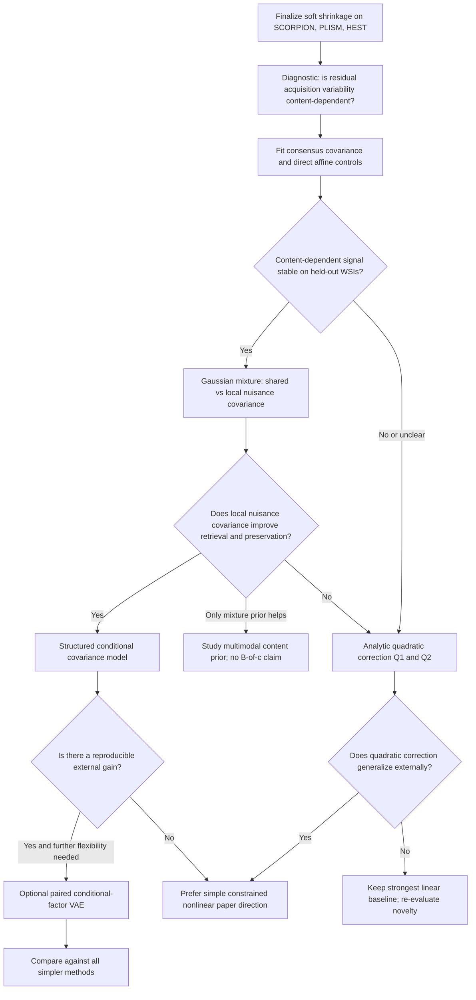

> **Source:** brainstorming result pasted by the user on 2026-10-13, kept verbatim below. It is
> the plan for this branch (`valentin/acquisition-shrinkage`). Status and results live in
> `docs/progress.md`; numbers there are generated from run files, numbers here are not.
>
> **Already superseded on 2026-10-13** (see `docs/progress.md`):
> - The new soft-shrinkage selection rule has a SCORPION test row (λ=0.5,
>   `runs/bench/2026-10-13_17-45-08_lxbelshark_db10_scorpion_softshrink_h0mini_gap_gain95`).
>   PLISM/HEST for the eraser are still pending: they need a `backbone_gap` + eraser extractor in
>   `sipe.bench`.
> - The soft-shrinkage deltas are slide-to-mean scanner deltas. On SCORPION every slide has the
>   same tile set on every scanner, so they equal the mean of tile-pair deltas (slide-level
>   pairing, see Experiment 2C).

# Experiment roadmap: from soft shrinkage to generative acquisition modeling

**Project:** SCORPION → PLISM / HEST · **Target:** 4-page ISBI submission (planned deadline: 26 October 2026)  
**Status:** Working research plan, not a claim that the proposed models will outperform the baseline  
**Decision rule:** Select a paper direction from *generalization and preservation results*, not from architectural elegance or training-set fit.

## 0. Global context and research question

### Why we are here

The original CATS work aimed to disentangle stain/acquisition-associated information from morphology using a frozen H0-mini backbone, a learned projection, reconstruction, adversarial objectives, and latent swapping. The COMPAYL reviews questioned whether better cosine similarity represented meaningful disentanglement: retrieval and downstream performance deteriorated, while a strong baseline was missing.

We adapted this research line to **scanner variation in SCORPION** and evaluated on WSI-disjoint tissue and on **PLISM** externally. The initial unpaired approaches (CATS, GRL/Fader VAE, MathieuGAN, distribution matching) have so far struggled to remove scanner information reliably or to improve external retrieval. A **paired VAE** improves correspondence retrieval, but its more complex decomposition is not yet justified against our previous **paired soft-shrinkage** method.

The COMPAYL soft-shrinkage approach solves a direct optimization problem rather than starting from a generative model. It learns a **single scanner-agnostic affine map** (global centering, then a linear operator), requiring no scanner label at inference. This property—and external generalization—should remain a central design goal.

### Existing experimental anchors (13 October 2026)

| Method | SCORPION held-out top-1 | SCORPION linear scanner probe | PLISM inter-scanner top-1 | HEST mean |
|---|---:|---:|---:|---:|
| H0-mini GAP | 0.802 | 0.956 | 0.811 | 0.364 |
| PairedVAE | 0.962 | 0.850 | 0.839 | 0.364 |
| Soft shrinkage, old choice $\lambda=100$ | 0.966 | 0.265 | **Pending** | **Pending** |

**Important:** the shrinkage test row above uses the *old* validation selection rule (maximum top-1, $\lambda=100$). The new rule—smallest $\lambda$ achieving 95% of the best validation retrieval improvement—still needs the corresponding final test, PLISM, and HEST results. The current headroom on SCORPION is tiny; **PLISM is essential for discriminating candidate methods**.

### Core question

> Can a **scanner-agnostic, statistically constrained nonlinear estimator** improve the acquisition-robustness versus morphology-preservation trade-off beyond the optimal global linear shrinkage map, and still transfer to acquisition domains not used for fitting?

A secondary question links back to CATS:

> Does explicitly modeling shared tissue content and variable acquisition effects provide a better inductive bias than adversarially removing scanner identity?

**Scope:** paired data are allowed at training/fitting time; **scanner ID is not supplied at inference**. An unpaired solution would be interesting future work, but is not required to motivate a paired SCORPION study. Do not claim total scanner invariance: strong correspondence retrieval can coexist with a decodable scanner signature.

## 1. Fix the experimental contract before fitting new models

This step is critical because otherwise apparent improvements could reflect changes in preprocessing, pairing, or hyperparameter selection.

- **Input:** frozen H0-mini GAP over patch tokens (768 dimensions), with its correct preprocessing. Save embeddings for each region, scanner, WSI, and split; use identical features for all methods.
- **Split:** preserve the existing WSI-disjoint train/validation/test protocol. Fit means, PCA bases, covariance matrices, gates, and all hyperparameters on training data only; choose hyperparameters on SCORPION validation only.
- **Pairing unit:** identify whether a method uses *tile/ROI-level matched acquisitions* or *slide-level scanner means*. Your original soft-shrinkage baseline uses slide-level displacements; a content-residual model may use individual ROI pairs. Mark this supervision difference explicitly and add matched-aggregation controls when possible.
- **Alignment:** account for SCORPION's imperfect spatial registration (notably P1000). A strong covariance difference might reflect registration/patch noise rather than scanner-specific imaging variation. Consider spatially pooled inputs or an ROI-level sensitivity analysis.
- **Inference contract:** every proposed map $f(x)$ takes one embedding as input, uses global fit parameters, and never requires the identity of the test scanner or the paired acquisitions.
- **Primary metric:** SCORPION cross-scanner top-1 (development); PLISM top-1 by inter-scanner, inter-stain, joint shift (external); HEST mean and individual tasks (preservation).
- **Diagnostics:** scanner probes (logistic regression and MLP), region probe, positive-vs-hard-negative similarity margins, covariance/effective-rank changes, and residual magnitudes. Scanner-probe chance accuracy is *not* the optimization target.
- **Reproducibility:** record fitting split, seed, hyperparameters, input pooling, feature provenance, and checkpoint/operator path. Reuse the results-table automation.

**External validation discipline:** avoid choosing $K$, $\lambda$, ridge strength, or the final paper method by repeatedly inspecting PLISM. It has already informed development, so describe it as an external benchmark rather than a perfectly untouched confirmatory test.

### Common reporting protocol

1. Select hyperparameters by **SCORPION validation** retrieval subject to a morphology-preservation guard.
2. Freeze the estimator; run **SCORPION held-out test**, **PLISM**, then **HEST**.
3. Include comparisons **per PLISM slide pair**, with scanner-/stain-specific breakdowns and attention to the known HR-stain failure.
4. Use paired/group-aware confidence intervals (PLISM observations share slides), plus additional fitting/training seeds where feasible.
5. Prefer the **simpler** model when gains are small, unstable, or restricted to seen scanners.

---

## 2. Experiment 0 — Complete the original soft-shrinkage baseline

**Why first?** A new generative model has little publication value if it cannot beat the already-strong, extremely simple correction from the previous paper.

### Method

For centered embeddings $u=x-\mu$, the original paired-delta objective is

$$
\min_P\; \mathbb E\|Pu-u\|_2^2
+\lambda\mathbb E\|P\Delta\|_2^2,
\qquad
P^*=A(A+\lambda B)^{-1},
$$

where $A$ is the **observed embedding covariance** and $B$ is the **paired displacement second moment** (or other chosen joint nuisance matrix). The deployed map is

$$f_0(x)=\mu+P^*(x-\mu).$$

This has an **analytic optimum over linear maps** for the stated preservation–attenuation objective. It is *not* derived by assuming that $A$ is the covariance of true latent content.

### Actions

- Finalize the new conservative $\lambda$ selection rule and sweep near the small-$\lambda$ retrieval plateau.
- Evaluate the selected operator on SCORPION test, **full PLISM**, and **full HEST**, using precisely the same embeddings as PairedVAE.
- Preserve the $\lambda=100$ results as a diagnostic, *not* as the automatically preferred setting.
- Save the learned global mean, matrix/basis, fitting configuration, and per-pair PLISM results.

**Decision D0:** If shrinkage matches/exceeds PairedVAE externally and preserves HEST, treat it as the **main bar to beat**. If PairedVAE is better externally, quantify the gap and inspect whether a nonlinear effect or supervision difference explains it. Either way, continue to Experiment 1.

---

## 3. Experiment 1 — Does acquisition variability depend on content?

**Why this before training a model?** Content-adaptive covariance and a conditional VAE are worthwhile only if there is reproducible heterogeneity in acquisition effects, not merely random residuals or registration artifacts.

### Data and diagnostic

Let $x_{i,s}$ be the embedding of tissue region $i$ on scanner $s$. Compute a paired consensus and residual:

$$
\hat c_i=\frac1S\sum_{s=1}^S x_{i,s},\qquad
r_{i,s}=x_{i,s}-\hat c_i.
$$

The consensus is **an empirical target**, not guaranteed to be the scanner-free truth. In particular, it may retain common acquisition distortions.

1. Fit a *small*, training-only clustering of $\hat c_i$ (start $K=4$; optionally $K=2,8$). Use dimension-reduced/regularized features, and split by WSI.
2. From paired residuals, measure the residual second moment/covariance in each cluster. Compare traces, leading eigenvalues, and displacement energies along the existing nuisance basis.
3. Test **out-of-slide stability**: do the same patterns appear on held-out validation WSIs, not just the training slides?
4. Compare a constant global nuisance model with a content-conditioned model on **held-out residual prediction or likelihood**. Add a negative control: shuffle cluster/content assignments within the train split.
5. Inspect whether the signal is robust to spatial pooling and exclusion of badly registered regions.

**What counts as a positive result?** Meaningful between-cluster differences that replicate on unseen WSIs and improve held-out prediction of nuisance statistics relative to a constant-covariance model—not just a visible training-set variance difference.

### Decision D1

- **Clear, stable content dependence:** prioritize Experiment 3 (mixture/conditional covariance); keep the quadratic model as a competing non-generative family.
- **Weak or unstable evidence:** run the inexpensive linear controls (Experiment 2) and the low-rank quadratic test (Experiment 4), but postpone a neural $B(c)$ model.
- **Mostly registration-driven differences:** improve the observation/pairing protocol; do **not** train a covariance network to predict artifacts.

---

## 4. Experiment 2 — Properly specified linear statistical controls

**Why?** Separate the benefit of a different statistical *target* from the benefit of genuinely nonlinear modeling. These methods are cheap to fit and form useful controls for both a mixture model and a VAE.

### Models

**(2A) Consensus covariance shrinkage.** Estimate on paired training regions:

$$
C=\operatorname{Cov}_i(\hat c_i),\qquad
N=\mathbb E_{i,s}[r_{i,s}r_{i,s}^{\top}].
$$

Fit a globally centered map

$$f_{\mathrm{cons}}(x)=\mu+C(C+\alpha N)^{-1}(x-\mu).$$

At $\alpha=1$, with a balanced, consistently estimated empirical distribution and no mismatched regularization, this is the **best affine least-squares predictor of the within-region scanner consensus**. It is not automatically a predictor of true biological content, and for $\alpha\ne1$ it is a tuned attenuation variant.

**(2B) Direct affine consensus regression.** Fit

$$f_{\mathrm{reg}}(x)=Wx+b,
\qquad
\min_{W,b}\sum_{i,s}\|Wx_{i,s}+b-\hat c_i\|^2
+\eta\|W\|_F^2.
$$

Use ridge regularization if needed. **Sanity check:** at $\alpha=1$, without differing ridge assumptions, (2A) and unregularized (2B) should agree up to numerical precision in the balanced setup. If not, inspect definitions, weights, centering, and covariance normalization.

**(2C) Original objective, same pairing scale.** If (2A)/(2B) use ROI-level consensus and (0) uses slide means, repeat an ROI-based original soft-shrinkage control (if feasible) to isolate the effect of *pairing granularity*.

### Decision D2

- **Regression/consensus clearly improves external retrieval:** choose the appropriate linear base for the next generative model, but do not claim the difference proves Bayesian disentanglement.
- **Original soft shrinkage remains strongest:** keep its solution as the fallback/anchor for the nonlinear family.
- **All near-identical:** this strengthens the case for testing **content dependence**, not more linear estimators.

---

## 5. Experiment 3 — Gaussian mixture with content-dependent nuisance covariance

**Why first among nonlinear generative methods?** It is the minimal probabilistic test of $B(c)$ without committing to an encoder, adversarial training, or an unconstrained decoder. It is directly related to the CATS motivation: content and acquisition are modeled as separate sources of embedding variability.

### Model

For content regime $k\in\{1,\ldots,K\}$,

$$
\begin{aligned}
k&\sim\operatorname{Categorical}(\pi),\\
c\mid k&\sim\mathcal N(\mu_k,C_k),\\
n\mid k&\sim\mathcal N(0,N_k),\\
x&=c+n.
\end{aligned}
$$

Assuming conditional independence, the scanner-agnostic posterior-mean map is

$$
\begin{aligned}
f_{\mathrm{mix}}(x)
&=\sum_k p(k\mid x)
\left[\mu_k+C_k(C_k+N_k)^{-1}(x-\mu_k)\right],\\
p(k\mid x)&\propto\pi_k\,\mathcal N(x;\mu_k,C_k+N_k).
\end{aligned}
$$

**Do not use the true paired consensus for gating at test time.** The mixture responsibilities must come from the *single input* $x$. Clustering training consensus vectors followed by moment estimation is a convenient **plug-in approximation**, not a full maximum-likelihood fit of the latent generative model.

### Essential ablation (isolates why the model helps)

| Variant | Content model | Nuisance model | Hypothesis tested |
|---|---|---|---|
| G0 | Global Gaussian | Global $N_0$ | Statistical linear baseline |
| G1 | Mixture of $K$ Gaussians | **Shared** $N_0$ | Does a multimodal content prior help? |
| G2 | Same mixture | **Cluster-dependent** $N_k$ | Does *content-dependent acquisition covariance* add value? |

Start with $K=2,4$ and strong shrinkage of $N_k$ **toward the common $N_0$**. Use ridge/diagonal or low-rank-plus-diagonal covariance estimation; multiple full 768×768 covariances can overfit severely. Regularize $C_k$ too. Consider $K=8$ only if validation supports increasing complexity.

Control possible systematic offsets: pooled residuals have zero mean *within each complete, balanced region across scanners*, but a fixed scanner can still have a nonzero mean effect. Make clear whether $N_k$ describes the **marginal** variation over scanners or an explicit scanner-conditioned model; this proposal is the former.

### Evaluation and decisions D3

- **G2 > G1 on held-out nuisance likelihood *and* SCORPION retrieval, without morphology loss:** evidence that $B(c)$ is useful → **conditional covariance estimator** (Experiment 5) is justified; possibly a constrained VAE (Experiment 6).
- **G1 > G0 but G2 ≈ G1:** non-Gaussian/multimodal *content* is useful; local nuisance covariance is not yet justified. Explore content priors before building $B_\theta(c)$.
- **Better likelihood but no retrieval improvement:** better generative fit is insufficient; do not promote G2 as the method without another demonstrated advantage.
- **Train improvement but validation deterioration / unstable gating:** reduce $K$, strengthen covariance shrinkage, or stop; unseen-scanner generalization is probably fragile.
- **No benefit at all:** move to the closed-form quadratic objective (Experiment 4). A VAE is **not** warranted solely because the mixture underperformed.

---

## 6. Experiment 4 — Analytic second-order correction (competing branch)

**Why try it?** This relaxes global linearity while keeping the original COMPAYL preservation–nuisance trade-off and a closed-form fitted solution. It is a mechanistic control for whether a neural/generative model is actually needed.

With $u=x-\mu$, define fixed low-dimensional nonlinear features $q(u)$ and $\phi(u)=[u;q(u)]$. Fit

$$
\begin{aligned}
f(x)&=\mu+W\phi(u),\\
\min_W\quad &\mathbb E\|W\phi(u)-u\|^2
+\lambda\mathbb E\|W(\phi(u_a)-\phi(u_b))\|^2
+\gamma\|W_q\|_F^2.
\end{aligned}
$$

With fixed features, this is a ridge-type quadratic optimization with an **analytic minimizer** (including regularization on the nonlinear block only). It returns the original full linear optimum as the nonlinear penalty becomes large, provided the same input statistics/objective and pairing protocol are used.

### Two variants, not a large search

- **Q1 — Nuisance squares:** $q_j(u)=(v_j^\top u)^2$ for a few fixed generalized nuisance directions $v_j$.
- **Q2 — Content × nuisance interactions:** $q_{jk}(u)=(w_j^\top u)(v_k^\top u)$ with $w_j$ from content PCA and $v_k$ from the nuisance basis. Limit the number of features (e.g., 8–16 per basis); regularize heavily.

These are **Taylor-inspired polynomial corrections**. They are not literally the Taylor expansion of the existing linear map. Q2 is also compatible with a local first-order expansion of a content-dependent nuisance covariance, but an arbitrary quadratic map **does not imply a valid positive-semidefinite $B(c)$**.

### Decision D4

- **Q2 improves PLISM and preservation over soft shrinkage:** a compact, analytically fitted nonlinear method may be enough for ISBI; a VAE needs to justify its extra complexity.
- **Q1 and Q2 improve SCORPION but not PLISM:** strong evidence of overfitting to seen acquisition geometry; prefer a stronger prior or return to the global linear estimator.
- **Neither helps:** favor statistical mixture/conditional-covariance modeling *only if Experiment 3 demonstrated held-out content dependence*; otherwise don't add a neural network by default.

---

## 7. Experiment 5 — Explicit content-adaptive Bayesian shrinkage (only if D3 supports it)

**Motivation:** Make the content-dependent nuisance covariance continuous rather than piecewise constant. Keep the *single-view, scanner-agnostic* inference rule and a statistically interpretable prior centered on the global model.

Start with a **small, structured covariance parameterization**, not a free 768×768 matrix:

$$
N_\theta(c)=U\,\operatorname{diag}(\sigma_\theta^2(c))U^\top+\epsilon I,
\qquad \sigma_\theta^2(c)>0,
$$

where $U$ is a fixed low-rank basis estimated from training-set paired displacements. Shrink the predicted log variances toward their global values, for example

$$\mathcal L_{\mathrm{prior}}
=\mathbb E_c\sum_j
\frac{[\log\sigma_{\theta,j}^2(c)-\log\sigma_{0,j}^2]^2}{\tau_j^2}.$$

Use a scanner-robust proxy $\hat c_0(x)$ as the condition, for example the global consensus-based shrinkage output. Estimate variance parameters from the **training paired residuals**, with a pair-consistency regularizer for the predicted nuisance covariance.

A first practical inference rule is the plug-in map

$$f_\theta(x)=\mu+C_0[C_0+N_\theta(\hat c_0(x))]^{-1}(x-\mu).$$

This is **not generally the exact Bayes posterior mean**, because the noise covariance depends on the unknown content and we have substituted a point estimate. Call it *plug-in conditional Gaussian shrinkage*. Also note: its constant-covariance limit recovers the **consensus Gaussian estimator**, not necessarily the original COMPAYL objective-based eraser. If exact fallback to the original eraser is required, construct a distinct objective-anchored parameterization and state its interpretation separately.

**Training/fit cost:** may require optimization of a few parameters (e.g. log-variance coefficients); unlike the fixed-feature quadratic correction it is not generically closed-form. Start with linear or tiny-MLP log-variance predictors, initialized at the global model.

**Decision D5:** Continue only if the conditional estimator has reproducible **external** benefits relative to G1/G2, original soft shrinkage, and quadratic controls without material HEST degradation. If not, a more expressive encoder/decoder is unlikely to be justified by the available evidence.

---

## 8. Experiment 6 — Where a VAE belongs (optional neural branch)

A VAE is **not necessary** to obtain Bayesian shrinkage. It becomes interesting when fitting a content prior and conditional acquisition mechanism explicitly is valuable, and simpler Gaussian/mixture models have shown a reproducible limitation.

### Restrained generative model in embedding space

$$
\begin{aligned}
c_i&\sim\mathcal N(0,I),\\
a_{i,s}&\sim\mathcal N(0,I),\\
x_{i,s}&=g_\theta(c_i)+U_\theta(c_i)a_{i,s}+\epsilon_{i,s}.
\end{aligned}
$$

The conditional noise covariance is $U_\theta(c)U_\theta(c)^\top+\operatorname{Cov}(\epsilon)$. For paired views, **the latent tissue content $c_i$ is shared**, while acquisition effects can differ. Fit with a reconstruction likelihood, KL terms, and a paired-content constraint. Constrain the decoder (low-rank nuisance factor, near-identity content mapping or fixed nuisance basis), rather than permitting arbitrary feature reconstruction. This is the conceptual bridge to CATS/Mathieu's specified–unspecified factorization.

**Single-view inference is mandatory:** the final estimator must be $f(x)=\mathbb E_{q_\phi(c\mid x)}[g_\theta(c)]$ or an equivalent content representation, with no scanner identity and no paired view required at test time.

**Identifiability warning:** KL and reconstruction alone do not guarantee that $c$ excludes scanner identity. A learned decoder can hide or overwrite scanner effects. Use independently trained scanner probes, content probes, and swapped-latent diagnostics. A scanner-level shared random effect is a separate model choice; it usually raises an additional test-time inference/calibration issue for unseen scanners.

### Decision D6

- **VAE > analytical/statistical baselines on PLISM, similar HEST:** strong evidence for a learned generative contribution; perform ablations of nuisance factorization, paired-content coupling, and prior strength.
- **VAE ≈ best Gaussian/mixture model:** report the simpler fit-only model unless generation or uncertainty estimation delivers another verified benefit.
- **Better reconstruction but worse correspondence or morphology:** reject as a retrieval method, even if its latent or translation plots look compelling.

---

## 9. Routing: what do we run next?

**The branches are not mutually exclusive scientifically:** run linear controls and one compact quadratic test even if the mixture looks promising. Avoid turning this into an exhaustive architecture search under a short submission deadline.

## 10. Non-negotiable evaluation for any shortlisted method

| Test | Why it matters | Pass criterion (pragmatic, not a statistical theorem) |
|---|---|---|
| SCORPION WSI-disjoint retrieval | Direct paired-acquisition adaptation | Competitive with the best linear baseline; beware saturation near 0.97 |
| PLISM external inter-scanner retrieval | Main transfer test | Reproducible improvement or a clearly better robustness–preservation trade-off |
| PLISM inter-stain and joint shift | Out-of-training-distribution behavior | No unexplained major degradation; inspect HR explicitly |
| PLISM scanner-model strata | Generalization to unseen hardware | Gains not restricted to scanner models shared with training; verify model identities from metadata |
| HEST all 10 tasks | Retained biological utility | Mean and per-task performance comparable; report variability, not only averages |
| Probe and embedding geometry | Detect collapse/shortcut solutions | No strong decrease in effective rank, negative-pair margins, or region separability |
| Fit-seed / train-seed variation | Reliability | Improvement is not a single-seed accident |

**Scanner-probe reduction is a diagnostic, not the primary success criterion.** Your own experiments show that acquisition-robust nearest-neighbor geometry and full removal of scanner-decodable information are different properties.

### If time allows: leave-one-scanner-out

PLISM provides stronger *external dataset* validation, while SCORPION leave-one-scanner-out (LOSO) isolates *unseen scanner within a controlled tissue distribution*. For the 4-page deadline, prioritize PLISM and stratify scanner models into training-overlapping versus unseen; run LOSO only if a new nonlinear model shows promise and its extrapolation claim needs stronger causal isolation. Be explicit that PLISM scanner-stratification is not a substitute for all the controls in LOSO.

## 11. Paper-direction decision and minimum viable ISBI package

| Observed winner | Potential claim | Main risk |
|---|---|---|
| Covariance/affine statistical estimator | A better-specified paired consensus target explains improved harmonization | May be too incremental relative to COMPAYL |
| Fixed-feature quadratic correction | Restricted second-order interactions improve unseen-domain robustness over the optimal global linear map | Improvement may disappear on PLISM |
| Gaussian mixture / content-adaptive covariance | Explicit content-dependent acquisition statistics enable scanner-agnostic nonlinear harmonization | High-dimensional covariance estimation and mixture gating may fail out of distribution |
| Constrained factor VAE | Paired generative modeling of content and acquisition beats non-generative/statistical alternatives | Harder to identify and reproduce; needs compelling ablations |
| No robust winner | Negative/diagnostic analysis explaining why linear correction is strong | Might not provide enough positive methodological novelty for ISBI |

For a **4-page paper**, aim for one central new estimator, the previous soft-shrinkage method, the strongest appropriate linear/generative controls, one revealing ablation, and one compact figure demonstrating transfer rather than an inventory of all unsuccessful architectures. The CATS contribution can be framed as the motivation for separating acquisition and tissue factors; acknowledge technical differences rather than implying the new method is the original CATS architecture.

### Suggested execution order under the current deadline

- **Day 1:** complete original shrinkage PLISM/HEST; freeze evaluation rules; compute the content-dependence diagnostic.
- **Day 2:** fit global consensus Gaussian, direct affine regression, and G1/G2 mixtures; screen on SCORPION validation.
- **Day 3:** implement Q1/Q2 quadratic controls; inspect whether any nonlinear benefit survives stricter regularization.
- **Days 4–5:** take **one** winner into either a structured $N_\theta(c)$ model or a minimal conditional-factor VAE *only if justified by earlier results*.
- **Remaining time:** external benchmark runs, replication/statistical checks, one main results figure, and manuscript writing. Stop architecture development early enough to leave time for the paper.

### Concrete stopping rules

- **Stop adding complexity** if no candidate shows a convincing gain on SCORPION validation over the appropriately selected soft-shrinkage baseline.
- **Stop promoting a candidate** if PLISM degrades meaningfully or HEST reveals a consistent utility cost.
- **Do not equate** stronger reconstruction or lower scanner-probe accuracy with better correspondence retrieval.
- **Do not describe** the plug-in $N(c)$ estimator as an exact Bayesian posterior, or the empirical consensus as guaranteed nuisance-free morphology.
- **Do not claim unseen-scanner generalization** based only on WSI-disjoint SCORPION testing of known scanner identities.

## 12. Deliverables checklist

- [ ] Final soft-shrinkage operator, selected $\lambda$, and SCORPION / PLISM / HEST outputs
- [ ] Stable per-region paired consensus/residual data representation, with split checks
- [ ] Content-dependence diagnostic including shuffled-content control
- [ ] Global consensus covariance model and direct affine fit
- [ ] Gaussian mixture G0/G1/G2 comparison with regularized covariances and single-view gating
- [ ] Analytic quadratic Q1/Q2 baseline and linear-fallback sanity test
- [ ] One conditional-covariance or VAE prototype **only if the decision gates support it**
- [ ] Unseen-scanner-model PLISM breakdown, paired confidence intervals, and HEST summary
- [ ] Selected ISBI paper claim, one model schematic, primary table, and one ablation/geometry figure

---

**Bottom line:** Start by completing soft shrinkage and measuring **whether nuisance variability is predictably content-dependent**. Fit inexpensive linear and mixture controls before choosing a neural architecture. Let the strongest externally generalizing result determine whether ISBI should be about (i) analytic second-order correction, (ii) content-adaptive probabilistic shrinkage, or (iii) constrained generative disentanglement in embedding space.
